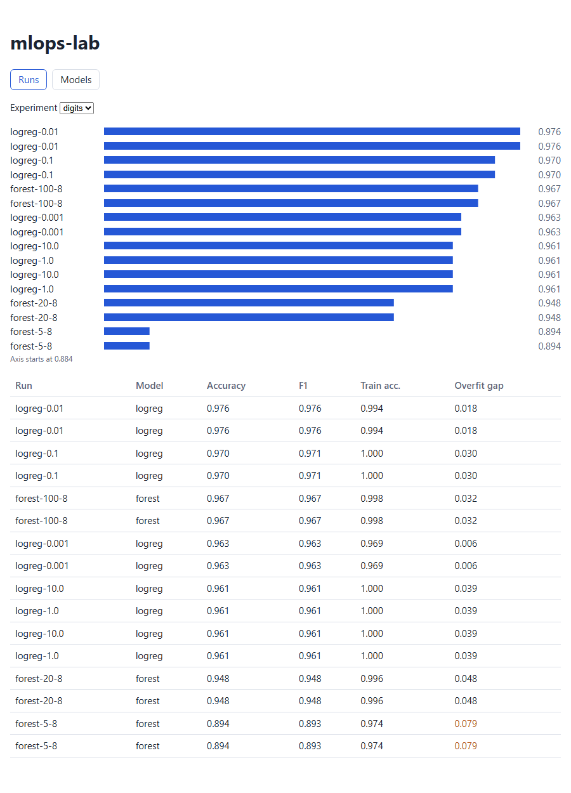
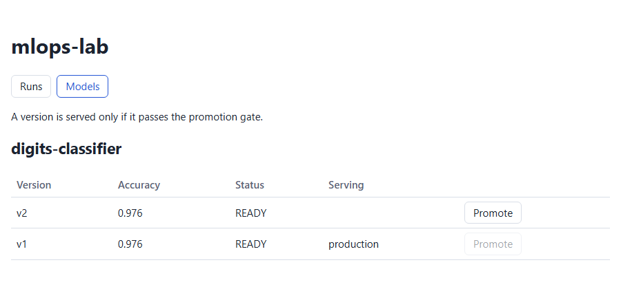

# mlops-lab

A small machine-learning platform: training runs are tracked in MLflow, the best model of each run is registered, and a **promotion gate** decides whether a new version may replace the one being served. A TypeScript service guards that decision, a React dashboard shows it, and the whole thing runs in Docker Compose or on Kubernetes.

```
trainer (Python job) ──> MLflow (runs, metrics, model registry)
                              ▲
              gateway (TypeScript / Node, REST) ── promotion gate
                              ▲
              dashboard (React, served by nginx, proxies /api)
```




## What is in here

| Part | What it does |
|---|---|
| `trainer/` | Trains logistic regression and random forest candidates on the digits dataset, logs params and metrics for every run, registers the best run as a new model version and tags it with its accuracy. It never promotes anything. |
| `gateway/` | Express + TypeScript. Typed client for the MLflow REST API, input validation, and the promotion gate. A version becomes `production` only if it reaches a minimum accuracy and beats the current production version by a margin. A refusal is a normal answer (HTTP 409 with the reason), not an error. |
| `dashboard/` | React + Vite + TypeScript. A runs table with an accuracy chart and an overfit warning, and a models page with a Promote button that shows the gate's reason. nginx serves it and proxies `/api` to the gateway. |
| `mlflow-server/` | MLflow tracking server and registry in one container (SQLite plus a local artifact folder). |
| `docker-compose.yml` | The whole stack on one machine. |
| `k8s/` | Kustomize manifests: probes, resource requests and limits, a volume for MLflow, two gateway replicas, non-root read-only gateway container, and a Job for training sweeps. |
| `scripts/smoke.py` | An end-to-end check of a running stack, used locally and in CI for both Compose and Kubernetes. |

## Run it

```bash
docker compose up -d --build --wait
docker compose --profile train run --rm trainer      # run it twice to get two versions
python scripts/smoke.py http://localhost:8080        # optional end-to-end check
# dashboard: http://localhost:8080   MLflow UI: http://localhost:5000
```

On Kubernetes (any cluster; images are expected to be loaded, for example with `kind load docker-image`):

```bash
kubectl apply -k k8s
kubectl -n mlops-lab create -f k8s/trainer-job.yaml
kubectl -n mlops-lab port-forward svc/dashboard 8080:80
```

Tests, per part:

```bash
cd trainer && pip install -r requirements.txt pytest && pytest -q      # 6 tests
cd gateway && npm ci && npm test                                       # 31 tests
cd dashboard && npm ci && npm test                                     # 8 tests
```

CI runs all of the above, then brings up the Compose stack and a `kind` cluster and runs the smoke test against each.

## Design choices worth a look

- **The gate is one pure function** (`gateway/src/promotion.ts`) with a test for each reason it can refuse: not ready, no accuracy recorded, already in production, below the minimum, regression, improvement too small to count. The HTTP layer only fetches facts and applies the decision.
- **Production is an MLflow alias, not a stage.** Stages are deprecated in current MLflow; an alias moves atomically, and rollback is promoting the old version again.
- **The gateway is the boundary.** Names, versions and query options are validated before anything reaches MLflow; MLflow failures become 502 with detail, unexpected errors become 500 with none.
- **Tested against real responses.** The client's tests use JSON captured from a running MLflow server. That mattered twice: MLflow answers a missing alias with HTTP 400 rather than 404, and its model serializer refuses to save random forests unless the scikit-learn tree type is explicitly trusted. Both would have passed against a hand-written mock.
- **SQLite means one MLflow pod and `Recreate` rollouts.** The manifest says so on purpose; a team would use Postgres and object storage.
- **MLflow checks Host headers** (DNS-rebinding protection), so the in-cluster and Compose service names are allow-listed explicitly rather than allowing every host.

## Not done yet

- Authentication on the gateway and the dashboard.
- Postgres and object storage for MLflow, more than one MLflow replica.
- Ingress, autoscaling, and actually serving the production model behind an endpoint.
- Drift monitoring and scheduled retraining.
